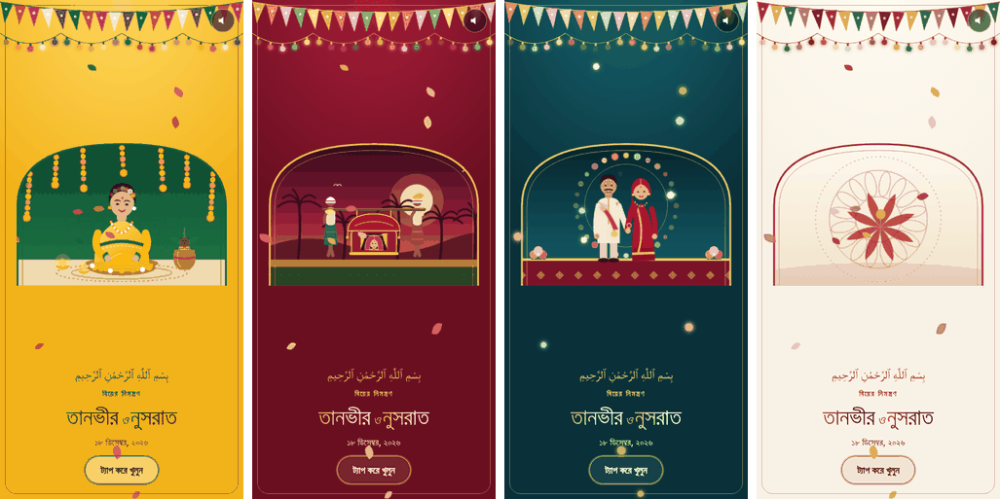
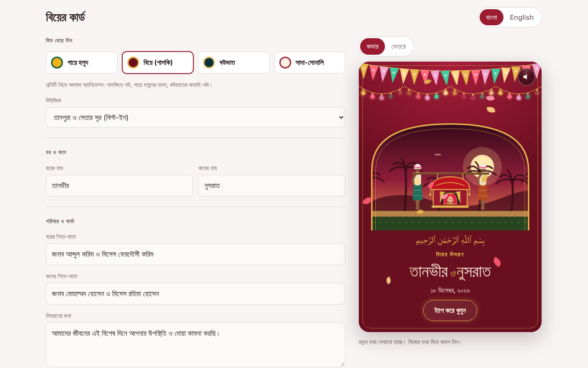

<div align="center">

# বিয়ের কার্ড · Biyer Card

**Create a beautiful animated Bangladeshi wedding invitation and share it with one link.**

Fill in a form, pick a theme, and send the card on WhatsApp. No app, no sign-up, no design skills.

<br>

[](https://biyer-card.vercel.app)
[](https://vercel.com/new/clone?repository-url=https://github.com/Muhtasim-Masum-Hasnayen/Biyer-Card)


<br>



<sub>Gaye Holud · Biye (Palki) · Bou-bhat · Ivory and gold</sub>

</div>

---

## Contents

- [Features](#features)
- [Themes](#themes)
- [Live demo](#live-demo)
- [How it works](#how-it-works)
- [Run it on your computer](#run-it-on-your-computer)
- [Deploy to Vercel](#deploy-to-vercel)
- [Short share links](#short-share-links-optional)
- [Music](#music)
- [Project structure](#project-structure)
- [Tech stack](#tech-stack)
- [Privacy and security](#privacy-and-security)
- [Ideas for later](#ideas-for-later)
- [Author](#author)

## Features

- **Four animated themes.** Each theme draws its own scene, with coloured paper bunting (jhalor), blinking lights and falling petals around it.
- **Bangla and English.** One tap switches the whole card. Bangla mode uses Bangla digits and Bangla dates.
- **All three wedding events.** Gaye Holud, Biye and Bou-bhat can each be switched on or off, with their own date, time, venue and address.
- **Google Maps link** for every venue, built from the address you enter.
- **Live countdown** to the first event.
- **Tap-to-open card.** Guests see a cover first and open it with a tap.
- **Built-in music.** A tanpura drone with a sitar-style melody plays when the card opens, and a speaker button turns it off. No audio file is needed. You can also add your own tracks.
- **Share by link.** Every card gets its own link that opens the card only, without the builder.
- **WhatsApp message.** A ready-to-send invitation text with dates, venues and map links, copied in one click.
- **Parents' names, opening line and message.** Choose Bismillah, Shubho Bibaho, or no opening line.
- **Works on phones first.** The layout switches between Edit and Preview tabs on small screens and sits side by side on desktop.
- **Light and dark builder.** The form follows the device theme. The card keeps its own colours.
- **Autosaves your draft** in the browser, so a refresh does not lose your work.
- **Respects reduced motion.** Animations stop for people who turn motion off in their device settings.

## Themes

| Theme | Scene |
|---|---|
| **Gaye Holud** | A bride in yellow with flower jewellery, a holud tray, marigold garlands, a kolosh and flickering oil lamps |
| **Biye (Palki)** | A bride in a palki carried by two bearers through a sunset village with palm trees |
| **Bou-bhat** | The groom and bride side by side under a ring of blinking flowers, with hearts rising |
| **Ivory and gold** | A slowly turning alpona-style mandala with a lotus, for a quiet and formal card |

## Live demo

**https://biyer-card.vercel.app**

<div align="center">

</div>

## How it works

1. Open the site and choose a theme.
2. Enter the couple's names, families, events and contact number. The card on the right updates as you type.
3. Press **Create link**. Copy the link or the ready-made WhatsApp message and send it.
4. Guests open the link, tap the card, and see the invitation with music and a countdown.

## Run it on your computer

You need [Node.js](https://nodejs.org) 18 or newer.

```bash
git clone https://github.com/Muhtasim-Masum-Hasnayen/Biyer-Card.git
cd Biyer-Card
```

**Quick preview** (builder, themes, animation and music):

```bash
npx serve public
```

Open the address it prints, usually `http://localhost:3000`. Share links created this way carry the whole card inside the link, and they open fine.

**Full preview with the API:**

```bash
npx vercel dev
```

Vercel asks you to sign in on the first run. Short `/c/<id>` links also need a database, see [Short share links](#short-share-links-optional).

You can also open `public/index.html` with the VS Code **Live Server** extension for a quick look at the builder.

## Deploy to Vercel

1. Fork or push this repository to your GitHub account.
2. On [vercel.com](https://vercel.com) choose **Add New, Project** and import the repository.
3. Keep the defaults (Framework Preset **Other**, no build command, no output directory) and press **Deploy**.

Or use the one-click button:

[](https://vercel.com/new/clone?repository-url=https://github.com/Muhtasim-Masum-Hasnayen/Biyer-Card)

The site works straight away. Pushing to `main` deploys a new version automatically.

## Short share links (optional)

Without a database, a share link holds the whole card, about 650 characters:

```
https://your-site.vercel.app/?d=...
```

With a free Redis database, links become short:

```
https://your-site.vercel.app/c/k7x2m9ab
```

1. In your Vercel project open **Storage**, choose **Create Database**, and pick **Upstash for Redis** (the free plan is enough).
2. Connect it to the project. Vercel adds the environment variables for you.
3. Open **Deployments** and **Redeploy** once.

| Variable | Purpose |
|---|---|
| `KV_REST_API_URL` or `UPSTASH_REDIS_REST_URL` | Redis REST address |
| `KV_REST_API_TOKEN` or `UPSTASH_REDIS_REST_TOKEN` | Redis REST token |

Saved cards are kept for one year. If the database cannot be reached, the site falls back to the long links, so sharing keeps working.

## Music

The built-in tune is generated in the browser with the Web Audio API. It starts when a guest taps **Tap to open**, because browsers only allow sound after a tap.

To offer your own music as well:

1. Create the folder `public/music/` and copy an mp3 into it, for example `public/music/shanai.mp3`.
2. List it in `public/config.js`:

```js
window.BIYER_CONFIG = {
  api: '/api/card',
  tracks: [
    { id: 'shanai', src: '/music/shanai.mp3', label: { bn: 'সানাই', en: 'Shanai' } },
  ]
};
```

Only use music you own or that is royalty-free, and keep files under 3 MB so the card opens quickly.

## Project structure

```
Biyer-Card/
├── public/
│   ├── index.html     Builder and card viewer in one page
│   ├── styles.css     Layout, themes and animations
│   ├── app.js         Form, card drawing, share links and built-in music
│   └── config.js      Site settings: API path and custom music tracks
├── api/
│   └── card.js        Saves and loads cards (Vercel serverless function)
├── docs/              Images used in this README
├── vercel.json        Serves /public and routes /c/<id> to the viewer
└── package.json
```

## Tech stack

- Plain **HTML, CSS and JavaScript**, with no framework and no build step
- **SVG** for the illustrations and **CSS animations** for the movement
- **Web Audio API** for the built-in music
- **Vercel** static hosting and one serverless function
- **Upstash Redis** (optional) for short links
- **Google Fonts**: Hind Siliguri, Tiro Bangla and Amiri

## Privacy and security

- Guests are never asked to sign in, and no tracking scripts are used.
- Everything typed into the builder is escaped before it is drawn, and the API only accepts known fields with length limits.
- Share links contain only what appears on the card. Do not enter private information you would not want on the invitation.

## Ideas for later

- A different link preview for each couple on WhatsApp and Facebook
- More themes, such as Mehendi and Reception
- Photo upload for the couple
- Guest RSVP with a response count for the host
- Downloading the card as an image or video

Suggestions are welcome. Open an [issue](https://github.com/Muhtasim-Masum-Hasnayen/Biyer-Card/issues) to share one.

## Author

**Muhtasim Masum Hasnayen**

[](https://github.com/Muhtasim-Masum-Hasnayen)

If this project helps you, a star on the repository is appreciated.

---

<div align="center">
<sub>Made in Bangladesh with love for every shubho bibaho.</sub>
</div>
